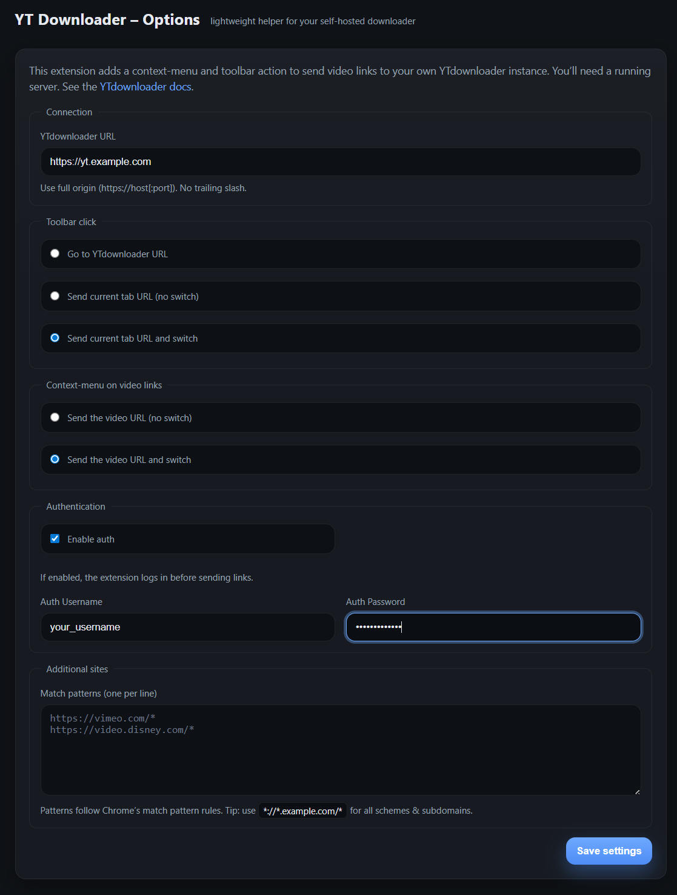

# YT Sender (Chrome Extension)

Send the current video link to your self‑hosted **[yt-dlp-web-ui](https://github.com/marcopiovanello/yt-dlp-web-ui)** instance — from the toolbar button or the right‑click context menu.

This extension is based on [MeTube-Chrome extension](https://github.com/Rpsl/metube-browser-extension)

## Installation

- [Install it from Chrome Web Store](https://chromewebstore.google.com/detail/gmiclfnkpkghcnhmhahkfjflfoobbphm)

---

## Features

- 🖱️ **Toolbar action** — send the active tab URL to your server or switch to the server tab (configurable).
- 📜 **Context menu** — right‑click a video link → *Send to YTdownloader*.
- 🔐 **Authentication** — optional login (supports plain‑text token responses and JSON; cookies included).
- 🧠 **Smart permissions** — uses MV3 `optional_host_permissions` and requests access only for the origin you configure.

---

### From source (developer mode)
1. Download / clone this repository.
2. Open `chrome://extensions/` and enable **Developer mode**.
3. Click **Load unpacked** and select the project folder (where `manifest.json` lives).
4. Done.

---

## Setup (first run)

1. Open **Options** (Extensions → YT Sender → Details → *Extension options*).
2. Enter your YTdownloader **URL** (e.g. `https://yt.example.com`, full origin, no trailing slash).
3. (Optional) Enable **Authentication** and provide username/password.
4. (Optional) Add **Additional sites** using Chrome match patterns (one per line).
5. Save settings.

> **Note:** On the first save and/or on first use, the extension will **request host access** for your configured origin (e.g. `https://yt.example.com/*`). You must approve it, otherwise sending will not work.

---

## How it works

- The extension uses an MV3 background **service worker**.
- It requests host access **at runtime** for the user‑configured origin (`optional_host_permissions` + `chrome.permissions.request`).
- If **Authentication** is enabled:
    - It calls `/auth/login`. The extension supports **text/plain** (quoted token string) and JSON responses.
    - When a token is present, it adds `Authorization: Bearer <token>` and `x-authentication: <token>`. It also sends cookies with `credentials: "include"`.
- Link dispatch is a POST to `POST <baseUrl>/api/v1/exec` with body:
  ```json
  { "url": "<videoUrl>" }
  ```

---

## Permissions

```jsonc
{
  "permissions": ["storage", "tabs", "contextMenus"],
  "host_permissions": [],                  // no hardcoded host
  "optional_host_permissions": ["*://*/*"] // runtime origin request
}
```

**Why these?**
- `storage` — store user settings.
- `tabs` — read the active tab URL and open/switch tabs.
- `contextMenus` — add the right‑click action.
- `optional_host_permissions` — access only the origin the user configured.

---

## Troubleshooting

- Open `chrome://extensions/` → **Inspect views** (Service worker) to see logs/errors.
- If sending fails:
    - Confirm you **approved** host access when prompted.
    - Check your server’s cookies (for cookie‑based auth): `SameSite=None; Secure` is recommended.
    - `/auth/login` may return a **quoted token string** as `text/plain`; the extension handles this.
    - Use HTTPS and ensure your server’s CORS policy allows the calls if applicable.

---
## Screenshots



---

## Privacy

This extension **does not collect** or transmit personal data. Settings are stored locally via `chrome.storage`. Network requests are only sent to the YTdownloader origin you configure.

---

## License

MIT License © ChesTeRcs
